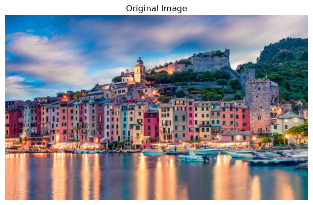
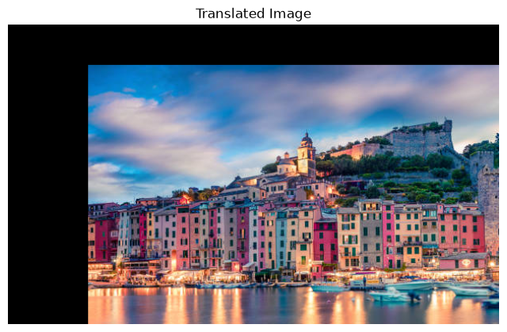
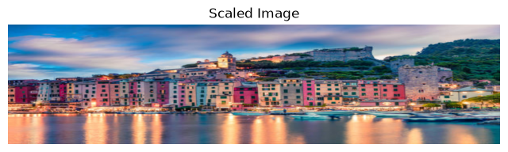
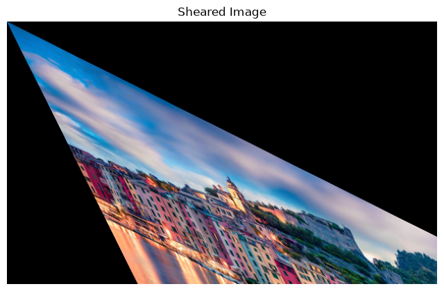
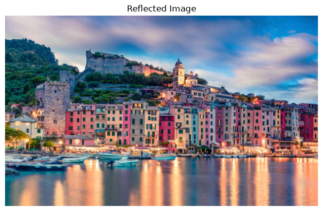
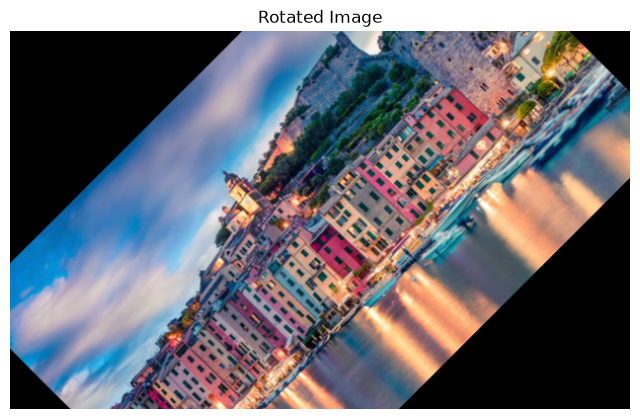
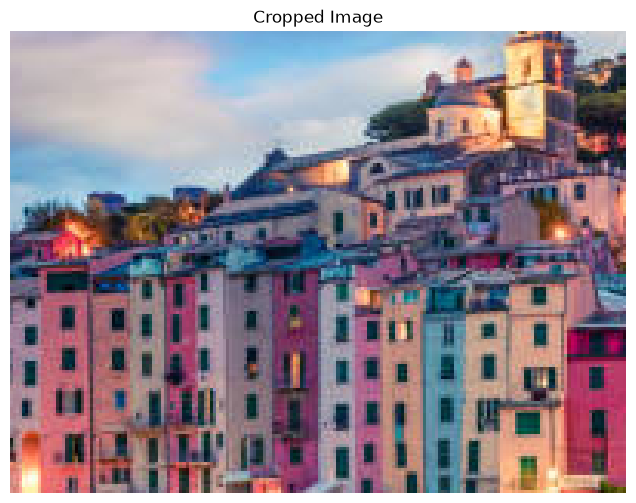

## EXP. NO: 04
# IMAGE-TRANSFORMATIONS

## Aim

To perform image transformations such as Translation, Scaling, Shearing, Reflection, Rotation, and Cropping using OpenCV and Python.

## Software Required

- Anaconda - Python 3.7
- OpenCV
- NumPy
- Matplotlib

## Algorithm

### Step 1
Import all the necessary modules.

### Step 2
Choose an image and save it as `city.jpg`.

### Step 3
Use `cv2.imread()` to read the image.

### Step 4
Use `cv2.warpAffine(image, M, (cols, rows))` to translate the image.

### Step 5
Use `cv2.resize(image, None, fx, fy)` to scale the image.

### Step 6
Apply shearing, reflection, and rotation by defining the appropriate transformation matrices.

### Step 7
Crop a specific region of the image and save the cropped image.

---

## Program

**Developed By:** Subashini K  
**Register Number:** 212225240160  

### i) Image Translation

```python
import cv2
import numpy as np
import matplotlib.pyplot as plt

# Step 1: Load the image
image = cv2.imread('city.jpg')  # Load the image from file

# Display the original image
plt.imshow(cv2.cvtColor(image, cv2.COLOR_BGR2RGB))  # Convert BGR to RGB for correct display
plt.title("Original Image")  
plt.axis('off')
plt.show()

# Step 2: Image Translation
tx, ty = 100, 50  # Translation factors (shift by 100 pixels horizontally and 50 vertically)
M_translation = np.float32([[1, 0, tx], [0, 1, ty]])  # Translation matrix: 
# [1, 0, tx] - Horizontal shift by tx
# [0, 1, ty] - Vertical shift by ty
translated_image = cv2.warpAffine(image, M_translation, (image.shape[1], image.shape[0]))

plt.imshow(cv2.cvtColor(translated_image, cv2.COLOR_BGR2RGB))  # Display the translated image
plt.title("Translated Image")  
plt.axis('off')
plt.show()
```

### ii) Image Scaling

```python
# Step 3: Image Scaling
fx, fy = 5.0, 2.0  # Scaling factors (width and height scaling)
scaled_image = cv2.resize(image, None, fx=fx, fy=fy, interpolation=cv2.INTER_LINEAR)
# resize: Resize the image by scaling factors fx, fy
# INTER_LINEAR: Uses bilinear interpolation for resizing

plt.imshow(cv2.cvtColor(scaled_image, cv2.COLOR_BGR2RGB))  # Display the scaled image
plt.title("Scaled Image")  # Set title
plt.axis('off')
plt.show()
```

### iii) Image Shearing

```python
# Step 4: Image Shearing
shear_matrix = np.float32([[1, 0.5, 0], [0.5, 1, 0]])  # Shearing matrix
# The matrix shears the image by a factor of 0.5 in both x and y directions
# [1, 0.5, 0] - Shear along the x-axis (horizontal)
# [0.5, 1, 0] - Shear along the y-axis (vertical)
sheared_image = cv2.warpAffine(image, shear_matrix, (image.shape[1], image.shape[0]))

plt.imshow(cv2.cvtColor(sheared_image, cv2.COLOR_BGR2RGB))  # Display the sheared image
plt.title("Sheared Image")  # Set title
plt.axis('off')
plt.show()
```

### iv) Image Reflection

```python
# Step 5: Image Reflection
reflected_image = cv2.flip(image, 2)  # Flip the image horizontally (positive value means horizontal flip)
# flip: 1/2 means horizontal flip, 0 would be vertical flip, -1 would flip both axes

plt.imshow(cv2.cvtColor(reflected_image, cv2.COLOR_BGR2RGB))  # Display the reflected image
plt.title("Reflected Image")  # Set title
plt.axis('off')
plt.show()
```

### v) Image Rotation

```python
# Step 6: Image Rotation
(height, width) = image.shape[:2]  # Get the image height and width
angle = 45  # Rotation angle in degrees (rotate by 45 degrees)
center = (width // 2, height // 2)  # Set the center of rotation to the image center
M_rotation = cv2.getRotationMatrix2D(center, angle, 1)  # Get the rotation matrix
# getRotationMatrix2D: Takes the center of rotation, angle, and scale factor (1 means no scaling)
rotated_image = cv2.warpAffine(image, M_rotation, (width, height))  # Apply rotation

plt.imshow(cv2.cvtColor(rotated_image, cv2.COLOR_BGR2RGB))  # Display the rotated image
plt.title("Rotated Image")  # Set title
plt.axis('off')
plt.show()
```

### vi) Image Cropping

```python
# Step 7: Image Cropping
x, y, w, h = 100, 100, 200, 150  # Define the top-left corner (x, y) and the width (w) and height (h) of the crop
# Cropping the image from coordinates (x, y) to (x+w, y+h)
cropped_image = image[y:y+h, x:x+w]
# The crop is performed by slicing the image array in the y and x directions

plt.imshow(cv2.cvtColor(cropped_image, cv2.COLOR_BGR2RGB))  # Display the cropped image
plt.title("Cropped Image")  # Set title
plt.axis('off')
plt.show()
```

---

## Output

### i) Input Image


### ii) Image Translation


### iii) Image Scaling


### iv) Image Shearing


### v) Image Reflection


### vi) Image Rotation


### vii) Image Cropping


---

## Result

Thus, different image transformations such as Translation, Scaling, Shearing, Reflection, Rotation, and Cropping were performed using OpenCV and Python programming.